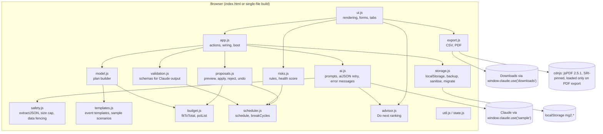
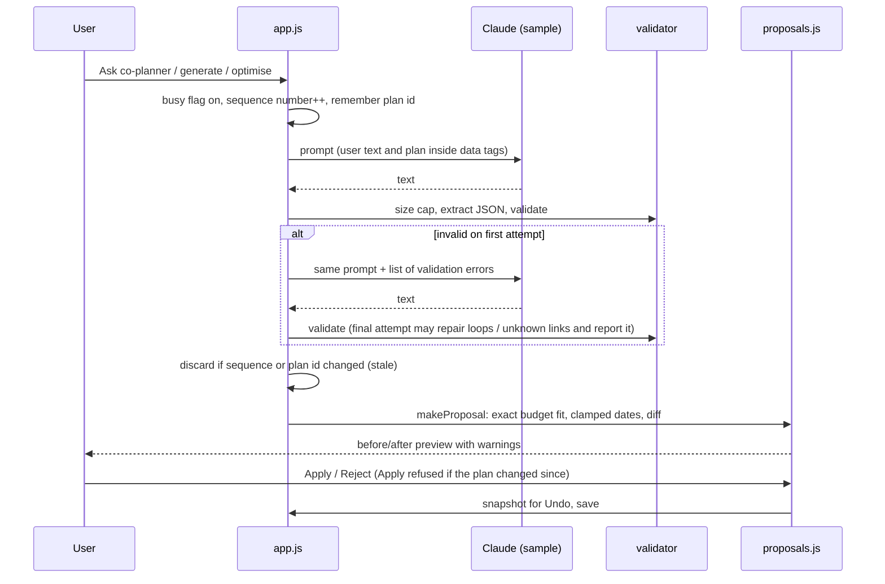

# Marigold architecture

Marigold is a client-only web app. There is no backend, no database server and no API key. Generative work goes through the Claude Artifact runtime (`window.claude.use("sample")`) when the app runs as a claude.ai Artifact. Everything else runs as plain, deterministic JavaScript in the browser.

## Design rule: Claude proposes, code decides

| Concern | Who does it | Where |
| --- | --- | --- |
| Writing a personalised plan, ideas, contextual risks, answers in chat, and proposed edits | Claude (generative) | `js/ai.js` prompts, called from `js/app.js` |
| Checking every Claude answer against a schema, with one retry that tells Claude what was wrong | Code | `js/validation.js`, `aiJSON()` in `js/ai.js` |
| Budget arithmetic (exact whole-number totals, committed spend as a floor, percentages that sum to 100.0) | Code | `js/budget.js` |
| Dates, scheduling, compression for short runways, dependency order, loop removal | Code | `js/util.js`, `js/scheduler.js` |
| Risk rules and the 0–100 health score (5 areas × 20 points) | Code | `js/risks.js` |
| "Do next": dependency-aware ranking of ready tasks and vendor deadlines, with reasons | Code | `js/advisor.js` |
| Before/after preview, apply, reject, undo, and stale-proposal detection | Code, with the user's approval | `js/proposals.js` |
| Saving, loading, migrating and sanitising plans | Code | `js/storage.js` |

No consequential change reaches a plan until the user presses **Apply** on a preview. Template and rule-based results are always labelled as such, never as AI output.

## Module map



`advisor.js`, `safety.js`, `budget.js`, `scheduler.js`, `risks.js`, `validation.js`, `model.js`, `templates.js` and `util.js` have no DOM access, so they are unit-tested directly with `node:test`.

## Request flow for a Claude call



## Data model (plan version 2)

```
plan = {
  v: 2, id, source: "ai" | "template" | "example" | "legacy", createdOn, createdAt, updatedAt, rev,
  brief:   { type, name, date, time, guests, venueCapacity, budget, currency, city, style, notes },
  budget:  [{ id, category, note, amount (integer), committed (integer | null) }],
  tasks:   [{ id, title, phase, offset (days before), fixedOffset, fixedDate, priority, deps: [taskId], done, origin }],
  vendors: [{ id, category, critical, status (6 stages), payment, name, contact, estimate, quote, bookBy, dueFixed,
              arrival, notes, checklist: [{ id, text, done }], questions, options, lineId }],
  ideas, runOfShow, dayOf: { contacts, emergency, weather }, aiRisks,
  history: [up to 10 undo snapshots], log, chat
}
```

Invariants enforced in code:

- `sum(budget.amount) === brief.budget` after every applied change; every amount is a whole number in `[0, 1e12]`.
- No budget line goes below its committed amount. If that is impossible, the change is refused with an explanation.
- Task dependencies only point at existing tasks and never form a loop. A task is never scheduled before a task it depends on, and nothing is scheduled in the past.

## Persistence

| Key | Contents |
| --- | --- |
| `mg2.plans` | Object of plans by id |
| `mg2.last` | Id of the last opened plan |
| `mg2.tab` | Last open tab |
| `mg2.migrated` | Set after a one-time import of version-1 plans from `mg.plans` |
| `mg2.plans.corrupt-<timestamp>` | Raw copy of unreadable data, made before anything new is written |

Loading never throws and never erases data. Unreadable JSON is backed up first; if the backup cannot be written, saving is paused for the session. Plans with a newer `v`, or that fail validation, stay in storage unchanged and are listed as hidden. Loaded plans are sanitised (amount ranges, dependency links and loops) and plan lookups use prototype-free objects and own-property checks.

## Builds

The source of truth is the modular app (`index.html`, `css/styles.css`, `js/*.js`). `npm run build` (`scripts/build.mjs`) produces:

- `dist/marigold-standalone.html`: one self-contained HTML file (CSS and JS inlined) that opens from disk.
- `dist/marigold-artifact.html`: the same content without the outer document tags, for publishing as a claude.ai Artifact.

The bundler orders modules by their imports, strips `import`/`export`, refuses duplicate top-level names, and wraps everything in one strict-mode function. `npm run build:check` fails if `dist/` is out of date. The browser test suite runs against both the modular app and the standalone build.

## Security headers

`index.html` sets a Content-Security-Policy: scripts only from the page itself and cdnjs (for jsPDF), styles from the page and Google Fonts, no plugins, no form posts, no fetch or XHR connections, and no `<base>` changes. The build replaces `'self'` in `script-src` with the SHA-256 hash of the inlined script for `dist/marigold-standalone.html`. The Artifact build leaves the policy out because claude.ai sets its own.

jsPDF is loaded with a Subresource Integrity hash (`JSPDF_SRI` in `js/safety.js`), `crossorigin="anonymous"` and `referrerpolicy="no-referrer"`, in both builds. `scripts/verify-sri.mjs` runs in CI and fails the build if the live cdnjs file no longer matches the pinned hash.

## Efficiency

- Only the visible tab panel is rebuilt on each change; the others render when opened.
- jsPDF is loaded lazily, only when a PDF is exported.
- Claude replies over 200,000 characters are rejected before parsing. Chat history sent to Claude is limited to the last 8 messages; prompts include at most 25 pending tasks.
- Undo history keeps 10 snapshots and falls back to 2 if browser storage is full.
