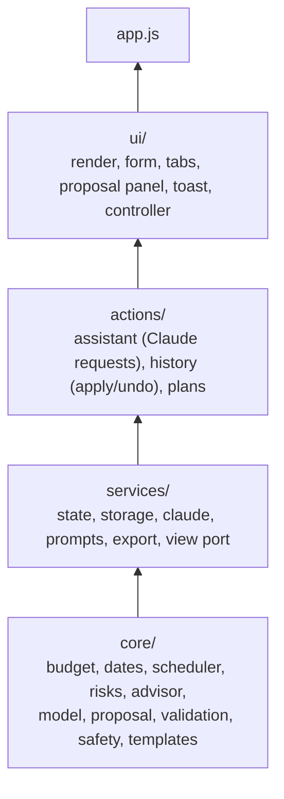
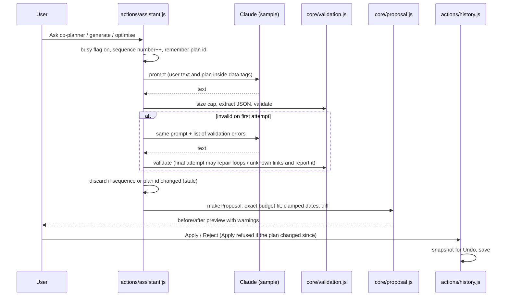

# Marigold architecture

Marigold is a client-only web app. There is no backend, no database server and no API key. Generative work goes through the Claude Artifact runtime (`window.claude.use("sample")`) when the app runs as a claude.ai Artifact. Everything else runs as plain, deterministic JavaScript in the browser.

## Design rule: Claude proposes, code decides

| Concern                                                                                                  | Who does it                    | Where                                                              |
| -------------------------------------------------------------------------------------------------------- | ------------------------------ | ------------------------------------------------------------------ |
| Writing a personalised plan, ideas, contextual risks, answers in chat, and proposed edits                | Claude (generative)            | `services/prompts.js`, called from `actions/assistant.js`          |
| Checking every Claude answer against a schema, with one retry that tells Claude what was wrong           | Code                           | `core/validation.js`, `askClaudeForJSON()` in `services/claude.js` |
| Budget arithmetic (exact whole-number totals, committed spend as a floor, percentages that sum to 100.0) | Code                           | `core/budget.js`                                                   |
| Dates, scheduling, compression for short runways, dependency order, loop removal                         | Code                           | `core/dates.js`, `core/scheduler.js`                               |
| Risk rules and the 0–100 health score (5 areas × 20 points)                                              | Code                           | `core/risks.js`                                                    |
| "Do next": dependency-aware ranking of ready tasks and vendor deadlines, with reasons                    | Code                           | `core/advisor.js`                                                  |
| Turning a requested change into a checked before/after preview                                           | Code                           | `core/proposal.js`                                                 |
| Apply, reject, undo, and stale-proposal detection                                                        | Code, with the user's approval | `actions/history.js`                                               |
| Saving, loading, migrating and sanitising plans                                                          | Code                           | `services/storage.js`                                              |

No consequential change reaches a plan until the user presses **Apply** on a preview. Template and rule-based results are always labelled as such, never as AI output.

## Layers

The code is split into four layers. Imports only point down, so there are no circular imports.

```
js/
  core/      pure planning logic: no DOM, no storage, no app state; runs unchanged in Node
  services/  app state, localStorage, the Claude client and prompts, export, the view port
  actions/   operations that change the plan: generate, optimise, apply, undo, open, delete
  ui/        rendering (one module per tab or panel) and event handlers
  app.js     start-up: connects the view, wires the page, restores the last plan, asks for Claude
```



How this is enforced:

- **ESLint** (`eslint.config.js`) forbids imports from a higher layer (`no-restricted-imports`) and browser APIs inside `core/` (`no-restricted-globals`). Logic in `services/` and `actions/` may not touch `document`.
- **The build** (`scripts/build.mjs`) refuses to bundle an import cycle.
- **A unit test** (`tests/unit/architecture.test.js`) walks the import graph and fails on a cycle, an upward import, or a browser API in `core/`.

### The view port (dependency inversion)

Logic often needs to tell the page something ("show this toast", "re-render the budget", "the Claude connection was declined"). Instead of importing the UI, `services/` and `actions/` call methods on `view` from `services/view.js`. At start-up `app.js` connects the DOM implementation (`domView` in `ui/controller.js`). Until then the methods are no-ops, which is also how the unit tests run the actions without a browser: they connect a recording fake.

## Module map

| Module                    | Responsibility                                                                |
| ------------------------- | ----------------------------------------------------------------------------- |
| `core/util.js`            | Numbers, strings, ids, `safeAmount`, `MAX_AMOUNT`                             |
| `core/dates.js`           | Strict `YYYY-MM-DD` parsing, day arithmetic                                   |
| `core/format.js`          | `escapeHtml`, money and date formatting                                       |
| `core/constants.js`       | Vendor stages, payment states, priorities, severities, contingency pattern    |
| `core/budget.js`          | `fitToTotal` (exact allocation), `pctList` (shares that sum to 100.0)         |
| `core/scheduler.js`       | Due dates, compression, dependency order, `breakCycles`                       |
| `core/risks.js`           | Budget, timeline, vendor and event risk rules; health score                   |
| `core/advisor.js`         | "Do next" ranking with reasons                                                |
| `core/model.js`           | Plan data model, `buildPlan`, `newVendor`                                     |
| `core/plan-sanitizer.js`  | `sanePlan`: rebuilds stored plans and undo snapshots from allow-listed values |
| `core/proposal.js`        | `makeProposal` (apply a change to a copy and check it), `diffPlans`           |
| `core/validation.js`      | Schemas for every Claude reply                                                |
| `core/safety.js`          | `extractJSON`, reply size cap, data fencing for prompts, jsPDF SRI pin        |
| `core/template-data.js`   | Built-in starter content per event type                                       |
| `core/templates.js`       | Expands template data into the generated-plan shape                           |
| `core/scenarios.js`       | Demo briefs on the welcome screen                                             |
| `services/state.js`       | The single app state object and request sequence numbers                      |
| `services/view.js`        | The view port (see above)                                                     |
| `services/local-store.js` | `localStorage` wrapper that never throws; storage keys                        |
| `services/storage.js`     | Load, save, back up, sanitise and migrate plans                               |
| `services/claude.js`      | `askClaudeForJSON` with validation and one retry; error messages              |
| `services/prompts.js`     | Prompt builders for generation, chat, optimizer, ideas and risk review        |
| `services/export.js`      | CSV (with formula-injection protection) and PDF export                        |
| `actions/assistant.js`    | Generate, optimise, more ideas, AI risk review, co-planner chat               |
| `actions/history.js`      | Show/apply/reject proposals, direct edits (`commit`), undo                    |
| `actions/plans.js`        | Open, create, review details, delete, sample plan                             |
| `ui/focus.js`             | Keeps keyboard focus on the edited control across re-renders (WCAG 2.4.3)     |
| `ui/*.js`                 | One module per area: form, saved plans, proposal panel, each tab, export menu |

## Accessibility

- Tabs follow the WAI-ARIA tabs pattern (arrow keys, Home, End). Panels and the plan title are programmatic focus targets (`tabindex="-1"`).
- Every re-render goes through `preserveFocus()` (`ui/focus.js`), so keyboard users stay on the control they edited; if it disappears (an applied proposal, a removed row), focus moves to its panel or the plan title, never to the page body.
- Form errors are linked with `aria-describedby` and announced with `role="alert"`; the toast switches between `status` and `alert`; the conversation is a `role="log"` region that only receives new messages.
- A skip link, visible focus rings, `prefers-reduced-motion`, `prefers-contrast` and `forced-colors` support. Status is never shown by colour alone.
- axe-core scans every tab in light and dark mode in the browser tests.

## Request flow for a Claude call



## Data model (plan version 2)

```
plan = {
  v: 2, id, source: "ai" | "template" | "example" | "legacy", createdOn, createdAt, updatedAt, rev,
  brief:   { type, name, date, time, guests, venueCapacity, budget, currency, city, style, notes },
  budget:  [{ id, category, note, amount (integer), committed (integer | null) }],
  tasks:   [{ id, title, phase, offset (days before), fixedOffset, fixedDate, priority, deps: [taskId], done, origin }],
  vendors: [{ id, category, critical, status (6 stages), payment, name, contact, estimate, quote, bookBy, dueFixed,
              arrival, notes, checklist: [{ id, text, done }], questions, options, lineId }],
  ideas, runOfShow, dayOf: { contacts, emergency, weather }, aiRisks,
  history: [up to 10 undo snapshots], log, chat
}
```

The same shape is documented as JSDoc types in `core/model.js`.

Invariants enforced in code (and covered by unit tests):

- `sum(budget.amount) === brief.budget` after every applied change; every amount is a whole number in `[0, 1e12]`.
- No budget line goes below its committed amount. If that is impossible, the change is refused with an explanation.
- Task dependencies only point at existing tasks and never form a loop. A task is never scheduled before a task it depends on, and nothing is scheduled in the past.

## Persistence

| Key                             | Contents                                                         |
| ------------------------------- | ---------------------------------------------------------------- |
| `mg2.plans`                     | Object of plans by id                                            |
| `mg2.last`                      | Id of the last opened plan                                       |
| `mg2.tab`                       | Last open tab                                                    |
| `mg2.migrated`                  | Set after a one-time import of version-1 plans from `mg.plans`   |
| `mg2.plans.corrupt-<timestamp>` | Raw copy of unreadable data, made before anything new is written |

Loading never throws and never erases data. Unreadable JSON is backed up first; if the backup cannot be written, saving is paused for the session. Plans with a newer `v`, or that fail validation, stay in storage unchanged and are listed as hidden. Loaded plans are sanitised (amount ranges, dependency links and loops) and plan lookups use prototype-free objects and own-property checks.

## Builds

The source of truth is the modular app (`index.html`, `css/styles.css`, `js/**`). `npm run build` (`scripts/build.mjs`, no dependencies) produces:

- `dist/marigold-standalone.html`: one self-contained HTML file (CSS and JS inlined) that opens from disk.
- `dist/marigold-artifact.html`: the same content without the outer document tags, for publishing as a claude.ai Artifact.

The bundler gives each ES module its own function scope that returns its exports, turns imports into destructuring from the modules they name, orders modules so dependencies come first, and fails on an import cycle or unsupported syntax. `npm run build:check` fails if `dist/` is out of date. The browser test suite runs against both the modular app and the standalone build. `dist/` is committed on purpose so the single-file app can be downloaded straight from GitHub; CI checks it matches the source.

## Security headers

`index.html` sets a Content-Security-Policy: scripts only from the page itself and cdnjs (for jsPDF), styles from the page and Google Fonts, no plugins, no form posts, no fetch or XHR connections, and no `<base>` changes. **There is no `'unsafe-inline'`.** The markup never uses `style=""` attributes; dynamic sizes (progress bars) are set through the CSSOM from `data-width` attributes, which the policy allows. For `dist/marigold-standalone.html` the build replaces `'self'` in `script-src` and `style-src` with the SHA-256 hashes of the inlined script and stylesheet. The Artifact build leaves the policy out because claude.ai sets its own.

jsPDF 4.2.1 is loaded with a Subresource Integrity hash (`JSPDF_SRI` in `core/safety.js`), `crossorigin="anonymous"` and `referrerpolicy="no-referrer"`, in both builds. `scripts/verify-sri.mjs` runs in CI and fails the build if the live cdnjs file no longer matches the pinned hash.

All dynamic values, including ids and enum fields, reach the page through `escapeHtml()` before they are placed in markup. Plans read from storage and undo snapshots are first rebuilt by `core/plan-sanitizer.js`, and AI proposals can set the event type, currency and start time only to allow-listed values. See [SECURITY.md](SECURITY.md) for the threat model.

## Efficiency

- Only the visible tab panel is rebuilt on each change; the others render when opened.
- jsPDF is loaded lazily, only when a PDF is exported.
- Claude replies over 200,000 characters are rejected before parsing. Chat history sent to Claude is limited to the last 8 messages; prompts include at most 25 pending tasks.
- Undo history keeps 10 snapshots and falls back to 2 if browser storage is full.
- `Intl` number and date formatters are created once and reused; a render formats hundreds of values.
- Stored plans are parsed and validated once per change: the parsed data and the saved-plans summary are cached against the raw stored text.
- The co-planner conversation is updated by appending new messages instead of rebuilding the list.
- Measured with `npm run bench` (41 saved plans): a task tick takes 18.7 ms median, down from 28.2 ms. The remaining cost is writing all plans to one `localStorage` key, which a per-plan storage layout would reduce; that would need a data migration and isn't done yet.
