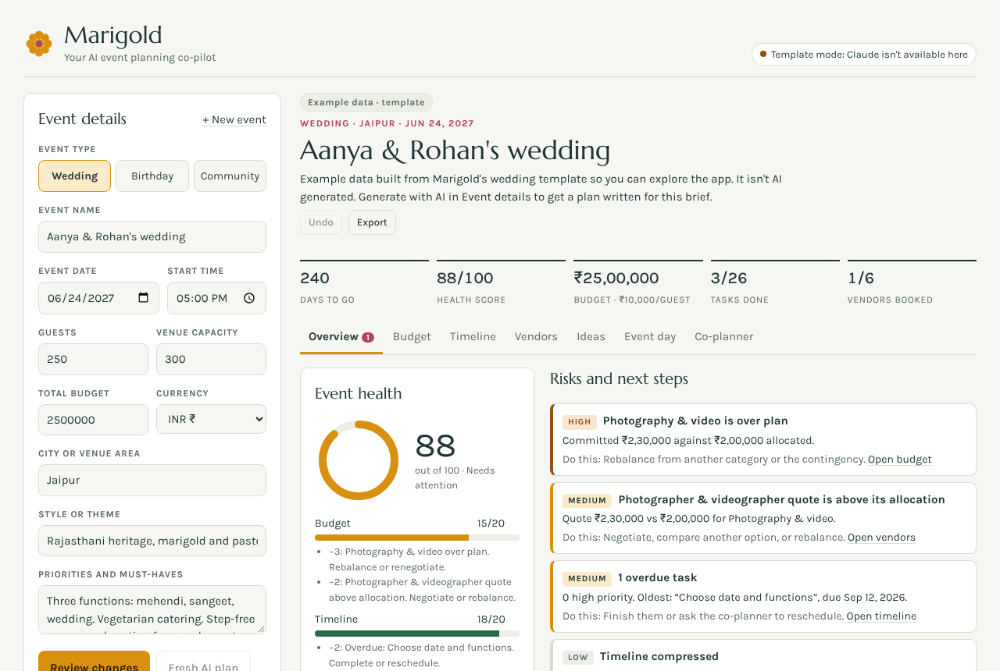
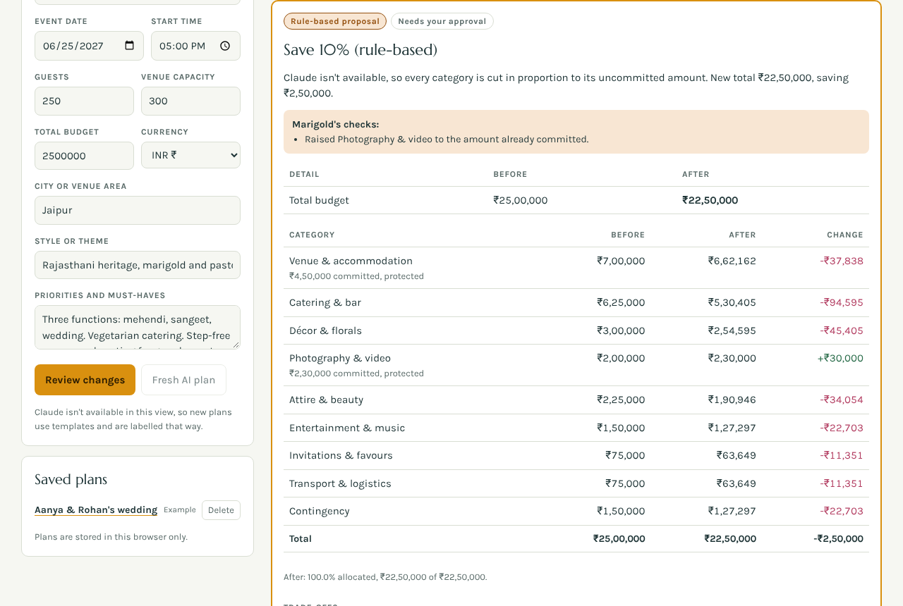
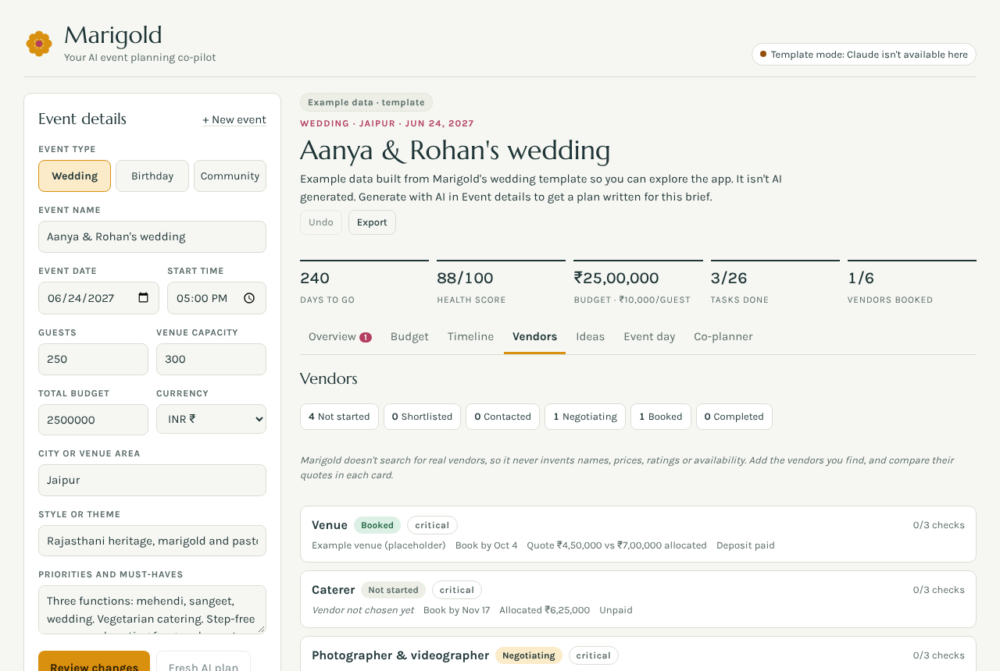
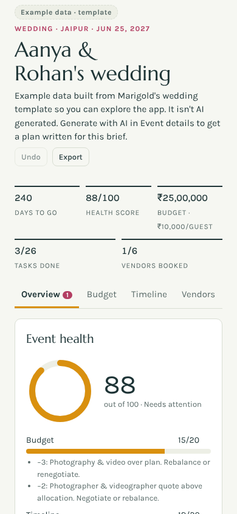

# Marigold: AI event planning assistant

**Hack2Skill Virtual PromptWars, Challenge 5: Celebration & Event Planner**

Marigold helps people plan weddings, birthdays and community events. It builds a budget, a timeline, a vendor checklist and personalised ideas from a short brief, then keeps the plan healthy as things change. Claude does the creative planning; plain code checks Claude's work, keeps the maths exact, and never changes the plan without the user's approval.

- **Live Artifact (runs with Claude):** https://claude.ai/artifact/RcrBY95y94zQQPAEgWdWAa (opens in claude.ai)
- **Offline single file:** [`dist/marigold-standalone.html`](dist/marigold-standalone.html) (template and rule-based features work without Claude)

## The problem

Planning a celebration means juggling a fixed budget, dozens of tasks with real deadlines, several vendors at different stages, and a stream of changes ("the budget dropped", "move it two weeks earlier"). Generic checklists don't adapt to the event, and AI chat answers are easy to get but hard to trust: totals don't add up, dates land in the past, and nothing tracks what was actually changed.

## The solution

Marigold pairs Claude with a deterministic planning engine:

1. You describe the event (type, date, guests, budget, city, style, priorities).
2. Claude drafts a personalised plan as structured JSON. Marigold validates it, asks Claude to fix anything invalid (once), fits the budget to the exact total, and schedules tasks so nothing is due in the past or before the task it depends on.
3. As plans change, you talk to the co-planner. Every edit Claude suggests becomes a **before/after preview** that you apply, reject, or later undo.
4. A rule-based **risk check** and **health score** watch the plan continuously, and an **event-day command center** keeps the day itself on track.

## Features

| Area | What it does |
| --- | --- |
| Plan generation | Claude writes a plan for the brief: budget split, 12–30 tasks in phases with dependencies, vendors with checklists and questions, ideas, run of show, contextual risks. Template plans are available without Claude and are labelled as templates. |
| Budget | Exact whole-number allocations that always add up to the total; committed spend is protected as a minimum; shares shown to one decimal always total 100.0%. |
| Budget optimizer | "Save 10/15/20%" with an optional "protect" note. Claude chooses where to cut and explains the trade-offs; code enforces the exact total and the committed floors. Without Claude, a labelled proportional cut is used. |
| Conversational editing | Ask for changes in plain language. Claude returns a structured proposal; Marigold shows the diff, warnings and trade-offs, and applies only on approval. Proposals go stale (and can't be applied) if the plan changes underneath them. |
| Undo and history | Up to 10 undo snapshots and an activity log that records AI, rule-based and manual changes. |
| Timeline | Phased tasks, priorities, dependencies, overdue and high-priority filters, automatic compression when the event is close. |
| Vendor manager | Six-stage status pipeline, payments, quotes vs allocation, book-by dates, checklists, questions to ask, and side-by-side options you enter yourself. Marigold never invents vendor names, prices or contacts. |
| Risks and health score | Deterministic rules (over budget, thin contingency, capacity exceeded, short runway, unbooked critical vendors, overdue tasks, missing weather backup and more) plus an optional Claude review for contextual risks. Health score: 5 areas × 20 points, with the reason for every deduction. |
| Ideas | Personalised ideas with rough cost ranges; ask Claude for more with a focus. Duplicates are rejected. |
| Event-day command center | Countdown, run of show, contacts, emergency kit and weather backup checklists. |
| Exports | Budget, vendors and timeline as CSV (with spreadsheet-formula injection guarded) and the full plan as PDF. Copy-to-clipboard fallback where downloads aren't available. |
| Onboarding | Three sample briefs (wedding, birthday, community event) and an explorable example plan. |

## How Claude is used

Marigold makes five kinds of Claude calls, all through `window.claude.use("sample")`:

1. **Plan generation** from the brief.
2. **Co-planner chat**, returning an answer and, when asked, a structured change proposal.
3. **Budget optimisation** with trade-offs.
4. **More ideas** with an optional focus.
5. **Contextual risk review** (season, local logistics, guest needs) on top of the rule-based checks.

Every call asks for strict JSON, is validated against a schema in `js/validation.js`, and gets one automatic retry that lists exactly what was wrong. User text and plan data are sent inside named data tags, and Claude is told not to follow instructions found inside them. Responses are discarded if the user has moved on (sequence and plan-id checks), and duplicate clicks are ignored while a request is running. The prompts tell Claude not to invent real business names, phone numbers, ratings, availability or live weather, and to treat all costs as estimates.

## Architecture

See [ARCHITECTURE.md](ARCHITECTURE.md) for the module map, request flow, data model and invariants (with Mermaid diagrams).

```
index.html            app markup (modular version)
css/styles.css        styles, light and dark themes
js/                   15 native ES modules (no framework, no build step needed to run)
scripts/build.mjs     bundles js/ + css/ into dist/ (standalone and Artifact files)
scripts/serve.mjs     small local static server for the modular version
dist/                 generated single-file builds (committed so they can be opened directly)
tests/unit/           node:test unit tests for the pure modules
tests/e2e/            Playwright browser tests + a clearly labelled Claude mock
docs/screenshots/     screenshots captured from the running app
```

## Tech stack

- HTML, CSS and vanilla JavaScript (ES2022, native ES modules). No runtime dependencies or framework.
- Claude through the claude.ai Artifact runtime (`sample` and `downloads` capabilities). No API key is used or stored anywhere.
- jsPDF 2.5.1, loaded from cdnjs only when a PDF is exported.
- Dev only: Node.js 18+, Playwright, axe-core, and a local jsPDF copy for offline tests.

## Install

```bash
git clone <your-repo-url> marigold-ai-event-planner
cd marigold-ai-event-planner
npm install            # dev dependencies only, used for tests
```

Playwright needs a Chromium browser. If you don't have one installed: `npx playwright install chromium`.

## Run locally

**Modular version** (ES modules need to be served over HTTP):

```bash
npm run serve          # http://localhost:8080
```

**Single-file version:** open `dist/marigold-standalone.html` directly in a browser.

Outside claude.ai there is no `window.claude`, so the app runs in **template mode**: templates, budget maths, the rule-based optimizer, risks, health score, timeline, vendors, exports and the event-day tools all work; the Claude features show that they need Claude.

## Run as a Claude Artifact

`dist/marigold-artifact.html` is the Artifact build. Publish it as a claude.ai Artifact with the `sample` (Claude) and `downloads` capabilities enabled. In the Artifact, Claude features switch on automatically when the viewer grants access. The live version is linked at the top of this file.

## Build the standalone files

```bash
npm run build          # writes dist/marigold-standalone.html and dist/marigold-artifact.html
npm run build:check    # fails if dist/ is out of date with the source
```

## Tests

```bash
npm test               # build check + unit tests + browser tests on both builds
npm run test:unit      # node:test, pure modules only
npm run test:e2e       # Playwright; MG_TARGET=modular or MG_TARGET=standalone to run one
```

Browser tests use a **mock** of the Claude runtime (`tests/e2e/mock-claude.js`), so they check Marigold's own logic and safety handling, not the quality of real Claude answers. See [TESTING.md](TESTING.md) for the latest executed results, what is not verified, and a manual checklist for testing with real Claude.

## Typical workflows

1. **New plan:** pick a sample brief or fill in Event details, then press *Generate plan with AI* (or *Use template* without Claude).
2. **Budget cut:** in Co-planner, type "My budget has been reduced to ₹20 lakh, protect catering". Review the preview, then *Apply* or *Reject*. *Undo* is in the plan header.
3. **Save money:** Budget tab, choose 10/15/20%, optionally say what to protect, review and apply.
4. **Track vendors:** Vendors tab, move each vendor through the stages, enter quotes and options you collected yourself.
5. **Event day:** Event day tab for the countdown, run of show, contacts and checklists.
6. **Share:** Export menu for CSV or PDF.

## Security and approval controls

- **No secrets:** no API keys or credentials anywhere in the code. Claude access comes from the viewer's own claude.ai session.
- **No backend:** all data stays in the browser's localStorage on the user's device.
- **Approval before change:** Claude can only propose edits. Nothing is applied without the user pressing *Apply*, and every applied change can be undone.
- **Untrusted AI output:** size-capped, parsed defensively, validated against schemas, retried once, and rendered only as escaped text (never as HTML).
- **Prompt injection:** user text and plan data are fenced in data tags with tag-closing attempts neutralised; the deeper defence is that code validates every result and the user approves every change.
- **Storage safety:** unreadable data is backed up before anything is written; newer-version plans are kept untouched; loaded data is sanitised; prototype-safe lookups.
- **Exports:** CSV text cells that start with `=`, `+`, `-`, `@`, a tab or a carriage return are prefixed with `'` so spreadsheets don't run them as formulas.
- **Inputs:** lengths are capped; money is limited to whole numbers from 0 to 1 trillion; dates are validated strictly.

## Assumptions

- Users plan one event per plan, in one currency. Changing currency relabels amounts; it does not convert them.
- Costs from Claude are rough estimates for the location, not quotes.
- "Today" is the device's local date.

## Limitations

- Claude features only work inside claude.ai as an Artifact. Elsewhere the app runs in template mode.
- Plans are stored per browser and device; there is no sync or sharing beyond exports.
- No live data: Marigold does not look up real vendors, prices, availability or weather.
- jsPDF is loaded from cdnjs without a Subresource Integrity hash, because the exact CDN bytes could not be verified from the build environment. PDF export needs network access to cdnjs.
- Prompt-injection fencing reduces risk but cannot guarantee Claude ignores every instruction in user text; code-side validation and user approval are the controls that matter.
- Automated tests use a Claude mock. Real Claude output quality has to be checked manually (see TESTING.md).

## Deployment

- **claude.ai Artifact:** publish `dist/marigold-artifact.html` with the `sample` and `downloads` capabilities.
- **Any static host** (GitHub Pages, Netlify, etc.): serve the repository root (or just `index.html`, `css/`, `js/`), or upload `dist/marigold-standalone.html` alone. Static hosting runs in template mode.

## Screenshots

Captured from the running app with Playwright (template and example data, no real Claude call):

| Overview | Proposal preview |
| --- | --- |
|  |  |

| Vendors | Mobile |
| --- | --- |
|  |  |

## Author and acknowledgements

- Author: Vishal Kunwar 
- Built for Hack2Skill Virtual PromptWars (Challenge 5), with Claude used as the in-app planning model and as a coding assistant.
- jsPDF (MIT) for PDF export; Playwright and axe-core for testing.
